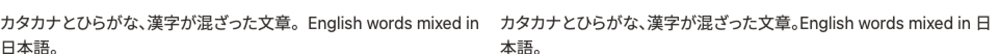

# Rendering parity

This page shows how closely the browser editor matches the HTML a server sends for the same document, in every browser, and where the remaining differences come from.

canvist renders a document three ways: the canvas editor, the server-rendered HTML it hydrates from (`canvist_layout::to_html` and the CSS it emits), and SVG. The pixel parity tests in `packages/canvist-web` render every fixture all three ways, side by side, in Chromium, Firefox, and WebKit on macOS and Linux. They hold the canvas to the DOM in two ways:

- **Geometry, to the browser's layout unit.** Every block's box, every text run, and every caret stop (the edges of every grapheme) is compared with the DOM's. Hydrating from SSR must not move anything.
- **Pixels.** The canvas and DOM screenshots are compared with pixelmatch (antialiased pixels excluded) and SSIM, against limits per browser and platform in `tests/parity/thresholds.ts`.

Each CI run uploads a side-by-side report (canvas | DOM | difference heatmap) as the `parity-<browser>-<os>` artifact. Run it locally with `test:web`, or:

```sh
cd packages/canvist-web
npx playwright test
node scripts/parity-report.ts   # writes report/parity/index.html
```

## The fixtures

| Fixture                             | What it checks                                                                          |
| ----------------------------------- | --------------------------------------------------------------------------------------- |
| System sans, serif, mono            | `ui-sans-serif`, `ui-serif`, `ui-monospace` stacks with every mark, lists, quotes, code |
| Inter                               | A variable web font (`wght`, `opsz`), upright and italic                                |
| Letter spacing                      | `letter-spacing: 1.5px` on body text                                                    |
| Sizes 10, 13, 24, 40, 64 px         | Inter at each size                                                                      |
| CJK                                 | Noto Sans JP split into two `unicode-range` subsets; mixed kana, kanji, Latin           |
| RTL                                 | Arabic and Hebrew paragraphs, and bidi runs inside an English line                      |
| Devanagari                          | Conjuncts and vowel signs                                                               |
| Emoji: system, COLRv1, OpenType SVG | ZWJ sequences, flags, keycaps, skin tones in Apple Color Emoji, Noto, and Twemoji       |

Each runs at device pixel ratios 1 and 2. Some also run at 3, at the fractional ratios browser zoom produces (1.25, 1.5, 1.75), and in the dark theme. Web fonts are subsets of open-licence fonts in `tests/fonts/`, built by `node scripts/fonts.ts`.

## What it found, and fixed

The first runs found real differences. Each was fixed in the web host or in layout:

- **Line boxes.** Canvas reports font ascent and descent rounded to whole CSS pixels, but each engine rounds line boxes its own way. Headings sat 0.8 px off in Chromium at 2×. The measurer now reads line boxes from the DOM. Unitless and pixel `line-height` round differently in Blink, so it probes with the same unitless form the HTML uses.
- **Kerning.** A kerning pair's adjustment belongs to its first glyph, but measuring prefixes put it on the second, which moved caret stops by up to 1.6 px. Japanese breaks between every character, so kana pairs lost their kerning entirely. Edges are now placed as the shaper places them, and adjacent segments kern.
- **Full-width punctuation.** Chromium's canvas trims the space between adjacent full-width punctuation (「。」), so the CSS contract now sets `text-spacing-trim: normal` instead of `space-all`.
- **Arabic caret stops.** Prefixes of Arabic words measured alone end in final forms, which put caret stops up to 12 px off. They now come from DOM ranges in context.
- **Line breaking in WebKit.** WebKit follows ICU's defaults (it breaks after `/` in URLs), not Blink's tailoring. Only Chromium gets the tailored rules now.
- **Fonts that resolve differently.** WebKit's DOM skips `ui-monospace` after a missing family, but its canvas honours it, so code drew in a different face. Fonts are now resolved against the DOM, and the StarterKit's code stack names fonts instead of `ui-monospace`.
- **Firefox font sizes.** Firefox's canvas snaps fractional font sizes (22.4 px headings) to steps its DOM does not use. Those fonts are now measured by the DOM.
- **Device pixels.** Baselines snap to the grid the browser snaps DOM text to. Borders snap down to device pixels, which put a blockquote's text 0.6 px off at 1.25×. On a high-density screen the backing store follows `devicePixelContentBoxSize`, unless an emulator reports CSS pixels there.

## Results

Largest difference across all fixtures and ratios, on macOS (Apple silicon):

| Browser  | Lines, blocks, baselines | Runs and caret stops | Differing pixels | Lowest SSIM |
| -------- | ------------------------ | -------------------- | ---------------- | ----------- |
| Chromium | 0.009 px                 | 0.115 px             | 0.067%           | 0.994       |
| WebKit   | 0.013 px                 | 0.25 px¹             | 0.72%            | 0.985       |
| Firefox  | 0.016 px                 | 0.32 px²             | 0.38%            | 0.90³       |

Excluding the documented exceptions below.

¹ WebKit reports text ranges as whole-pixel rectangles, so the tests can only locate a DOM caret stop to within a pixel. ² Firefox's character rectangles for some glyphs end 19/60 px past where the next character starts. ³ Glyph positions match, but Firefox draws optical sizes in canvas at quantized steps, so edges shade slightly differently.

## Irreducible differences

These remain, are covered by explicit limits in `tests/parity/thresholds.ts`, and are shown in every report:

**Firefox: full-width punctuation before Latin text.** Firefox applies contextual half-width spacing (OpenType `chws`) to full-width punctuation, depending on its neighbours on both sides. Layout measures Japanese one character at a time, so it can't see that context. A line holding 「。」 before Latin text can then wrap one character differently. Left is the canvas, right is the DOM:



**WebKit: Latin inside CJK paragraphs.** Latin text that falls back from a CJK web font measures up to 1.2 px apart in WebKit's canvas and DOM. Lines still wrap identically.

**WebKit: caret stops inside Arabic words** come from DOM ranges, which WebKit rounds to whole pixels. They can sit up to 2 px from the DOM's. Glyphs are unaffected.

**Antialiasing.** On macOS every engine renders canvas and DOM text with the same grayscale antialiasing: macOS has had no subpixel text since 10.14, and the canvas is opaque, so Chromium may use the same mode as the page. Remaining edge shading differences (the "edge shading" column in the report) come from glyphs a fraction of a pixel apart. Where a platform renders DOM text with LCD (subpixel) antialiasing, such as Chromium on Windows or Linux with a non-headless display, an opaque canvas lets Chromium use LCD text too. Firefox and WebKit draw canvas text in grayscale, which would show as colour fringes in the difference heatmap.
