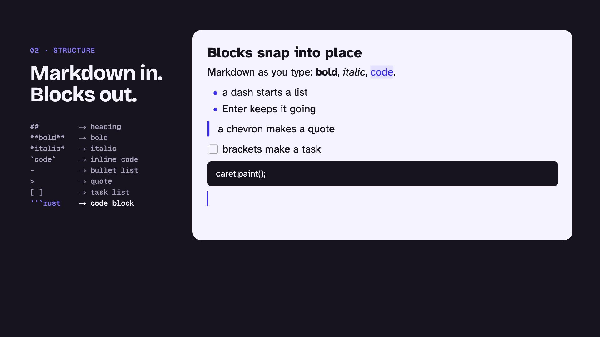

# canvist launch film

A 65-second film about canvist, made with [Remotion](https://www.remotion.dev) from **real canvist output**. Nothing in a document on screen is mocked up: every block is an SVG that `canvist_layout::to_svg` painted from a display list, at the position layout gave it.



## Render it

From this folder, with Node 22.18 or later and the Rust toolchain:

```bash
npm ci
```

```bash
npm run render
```

That one command:

1. Records the footage: `cargo run --release -p canvist_footage` (`tools/footage`) types scripts into StarterKit editors, lays them out with the `parley` measurer and the bundled Atkinson Hyperlegible faces, runs three `canvist_collab` peers over Yjs, and writes the frames to `public/footage/`. Keystroke timings are measured while recording, so the numbers on screen come from the machine that rendered them.
2. Reads the performance budget table from `docs/src/v2/architecture.md`.
3. Generates TypeScript declarations from the StarterKit's `metadata_json()` and type-checks a snippet that uses an extension the editor never registered, keeping `tsc`'s real error for the "headless and typed" scene.
4. Renders every cut into `out/` and the poster into `../assets/brand/video-poster.png`, and writes timings to `out/report.json`.

| Cut               | Composition      | File                               |
| ----------------- | ---------------- | ---------------------------------- |
| 16:9, 1920 × 1080 | `Launch`         | `out/canvist-launch-1080p.mp4`     |
| 16:9, 3840 × 2160 | `Launch` × 2     | `out/canvist-launch-4k.mp4`        |
| 9:16, 1080 × 1920 | `LaunchVertical` | `out/canvist-launch-9x16.mp4`      |
| 1:1, 1080 × 1080  | `LaunchSquare`   | `out/canvist-launch-1x1.mp4`       |
| 16:9, 960 × 540   | `Launch` × 0.5   | `out/canvist-launch-preview.mp4` ¹ |

¹ `npm run render:preview` renders only this one. CI renders it on every pull request that touches the film or the crates it films, and uploads it as an artifact.

Other commands:

- `npm run studio` opens Remotion Studio to scrub through the film.
- `node scripts/render.ts --stills 120,480 --composition LaunchSquare` renders inspection stills into `out/stills/`.
- `npm run typecheck` checks the project with strict TypeScript.

The footage, fonts, and brand paths in `public/` are generated, so rerun `npm run prepare:footage` after changing the product, the docs, or `tools/footage`.

## The scenes

| #  | Scene        | What is real                                                                                                                  |
| -- | ------------ | ----------------------------------------------------------------------------------------------------------------------------- |
| 00 | Mark         | The Wet Caret master from `assets/brand/vector/lockup.svg`, brushed on, its drop falling once, then the caret types the name. |
| 01 | Type         | A heading and paragraph typed key by key; the counter shows each key's measured cost from key event to display list.          |
| 02 | Structure    | Markdown shortcuts firing the StarterKit's input rules; blocks spring between the rectangles layout gave them.                |
| 03 | Move         | The code block dragged to the top; each slot it passes is a real `MoveBlocks` commit, relaid out.                             |
| 04 | Together     | Three peers over Yjs; every caret is a Yjs relative position resolved by `Presence`, and the replicas end identical.          |
| 05 | Reflow       | The same document laid out at 49 widths from 1040 to 368 pixels.                                                              |
| 06 | Everywhere   | The document at each platform's viewport and text size. The device frames are drawings; the screens are real layouts.         |
| 07 | Headless     | Declarations generated from `metadata_json()`, and the error `tsc` printed for them.                                          |
| 08 | Fast         | Rows of the budget table in `docs/src/v2/architecture.md`; each bar is the budget, its paint today's number.                  |
| 09 | Free forever | The Unlicense and the hosted services from `docs/src/v2/business.md`.                                                         |

## Motion language

The film moves the way the Wet Caret does, so it shouldn't look like a stock product video:

- **Typed, never faded.** Captions arrive a character at a time behind a caret and leave by being deleted. Nothing tweens its opacity.
- **The caret leads.** Each scene is swept in behind a full-height caret moving left to right, as if typed over the last.
- **Wet, then dry.** Whatever moves lands with a small overshoot, like paint settling (`WET` in `src/motion/time.ts`), then stays put.
- **Blink in hard steps.** Idle carets blink on a one-second cycle with no fade, as the brand guide asks, and the logo's drop falls once.
- **Real geometry.** Blocks and carets only move between rectangles layout computed. The film chooses when, never where.

Colours, type, and the caret follow `assets/brand/readme.md`: an Ink stage, Paper sheets, Paint carets on paper and Paint on dark on the stage, Bricolage Grotesque for captions, Geist Mono for numbers, and Atkinson Hyperlegible for documents, because that is the face the footage was measured with.

## Layout

- `src/Film.tsx`: the scene list, durations, and the caret sweep between scenes.
- `src/scenes/`: one file per scene.
- `src/motion/`: the page renderer (`Page.tsx`), the Wet Caret and typed captions (`Caret.tsx`), and the timing and spring helpers (`time.ts`).
- `src/data.ts`: loads and checks the footage.
- `scripts/prepare.ts`, `scripts/typed.ts`, `scripts/render.ts`: the pipeline above.
